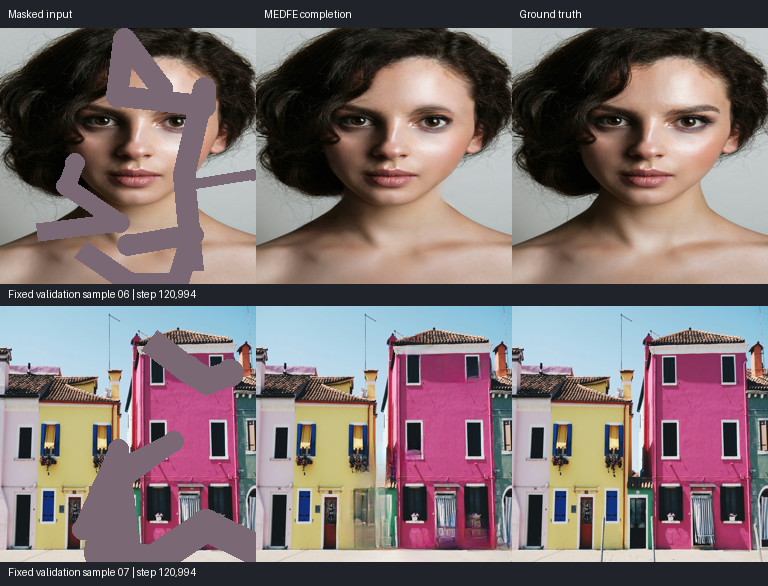
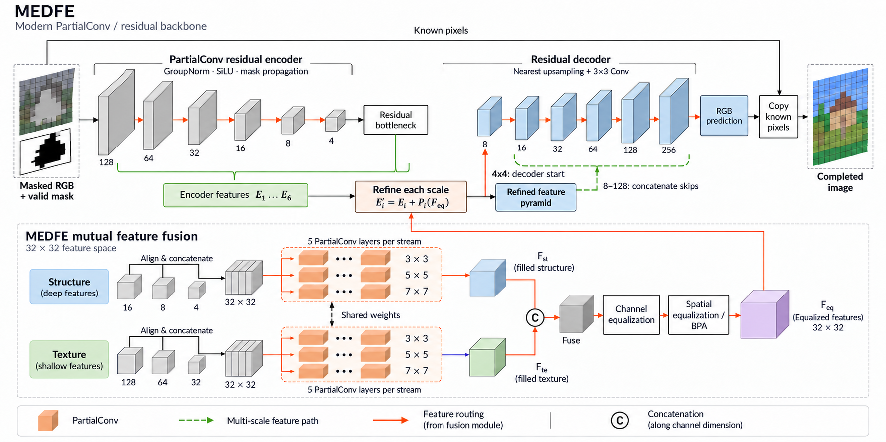

<div align="center">

# MEDFE
### Mutual Encoder–Decoder with Feature Equalizations

**ECCV 2020 · Modern PyTorch implementation**

[Paper](https://www.ecva.net/papers/eccv_2020/papers_ECCV/papers/123470715.pdf) · [Weights](https://huggingface.co/KumaPower/MEDFE) · [Quick start](#quick-start) · [Training](#training) · [Datasets](docs/data.md) · [Architecture](#architecture)

Hongyu Liu · Bin Jiang · Yibing Song · Wei Huang · Chao Yang

</div>



*MEDFE results. Each row shows masked input → completion → ground truth. [More examples and checkpoint details](docs/checkpoint.md).*

This repository is a new PyTorch implementation of **MEDFE**, which jointly recovers image structure and texture through a mutual encoder–decoder and feature equalization. It provides batched training, reproducible random masks, explicit configuration, resumable checkpoints, and offline inference.

The network combines a **PartialConv residual encoder** with a **GroupNorm/SiLU residual decoder**, using nearest-neighbor upsampling and ordinary convolutions. Structure and texture branches fill missing features through multi-scale partial convolutions, followed by channel equalization and bilateral propagation. A single forward pass produces the completed RGB image.

## Quick start

Python **3.10+** is required. The training environment used PyTorch **2.6.0**, torchvision **0.21.0** and CUDA **12.4**. For Linux/NVIDIA:

```bash
git clone https://github.com/KumapowerLIU/Rethinking-Inpainting-MEDFE.git
cd Rethinking-Inpainting-MEDFE
python3 -m venv .venv
source .venv/bin/activate
python -m pip install torch==2.6.0 torchvision==0.21.0 \
  --index-url https://download.pytorch.org/whl/cu124
python -m pip install -e .
medfe --help
```

For macOS or CPU, install the matching [PyTorch wheels](https://pytorch.org/get-started/previous-versions/#v260) before installing this package.

Download the **step 120,994** generator from [Hugging Face](https://huggingface.co/KumaPower/MEDFE), then run:

```bash
mkdir -p checkpoints
curl -L --fail \
  https://huggingface.co/KumaPower/MEDFE/resolve/main/medfe-sd-partial-step120994.pt \
  -o checkpoints/medfe-sd-partial.pt

medfe infer --checkpoint checkpoints/medfe-sd-partial.pt \
  --image examples/masked.png --mask examples/mask.png \
  --output outputs/completed.png --device cuda:0
```

**White mask pixels are holes; black pixels are known.** Image and mask must have matching dimensions. Inference preserves the original size through padding/cropping, copies known pixels exactly, and writes a lossless PNG. `--device cpu` is supported. The download is a **579.6 MB FP32 inference bundle**; [checkpoint details](docs/checkpoint.md) include its checksum and export instructions.

## Architecture



*Architecture overview, with a layout inspired by [Figure 2 of the paper](https://www.ecva.net/papers/eccv_2020/papers_ECCV/papers/123470715.pdf#page=5). Scale labels are spatial side lengths for a 256 × 256 input. The image tiles are schematic; model results are shown above.*

The generator is trained jointly. Equalized features are projected to each encoder scale and added to the encoder features; the resulting feature pyramid supplies the decoder input and skip connections. See the [architecture notes](docs/sd-partial-backbone.md) for feature scales, mask propagation and normalization.

## Training

The current recipe is [`configs/sd-partial-csa-mix-large-batch.yaml`](configs/sd-partial-csa-mix-large-batch.yaml).

| Setting | Current experiment |
| --- | --- |
| GPU | **1 × NVIDIA H100 80 GB HBM3** |
| Image size / batch | **256 × 256 / 128**, one GPU |
| Precision | BF16 training; FP32 perceptual computation and validation |
| Memory | About **33 GiB** process usage observed; **38 GiB** allocator budget |
| Measured short-test peak | 25.925 GiB allocated / 30.551 GiB reserved; synthetic full D/G test |
| Optimizer | Adam, lr `0.0002`, betas `(0.5, 0.999)` |
| Masks | Rectangles, brush strokes, or mixtures; 10%–40% missing area |
| Stop point | **120,994 steps**, paused with a complete training checkpoint |

The 80 GB card capacity is not the measured requirement. Memory varies with inputs, backends and image size; reduce batch size for smaller GPUs. [Training details](docs/training.md) include the loss definitions, warmup, resume rules and hardware measurements.

### 1. Prepare your images

Use separate training and validation folders. The indexer reads existing files; it does not download or extract a dataset.

```bash
python scripts/build_image_index.py --images-root /path/to/train \
  --manifest data/train.jsonl
python scripts/build_image_index.py --images-root /path/to/validation \
  --manifest data/validation.jsonl
```

The indexed reader resizes RGB to 256², computes a true RTV structure target, and caches it on first use. See [data preparation](docs/data.md) for storage requirements, archive formats, face sampling and the alternative paired-data protocol.

### 2. Prepare LPIPS weights

```bash
export TORCH_HOME="$PWD/weights/torch"
medfe prepare-weights --lpips-only --output weights
```

This explicitly fetches missing VGG-LPIPS assets. The current discriminators are randomly initialized PatchGANs and need no pretrained D. Training itself defaults to **no implicit downloads**.

### 3. Train and resume

```bash
medfe train --config configs/sd-partial-csa-mix-large-batch.yaml \
  --set train.device=cuda:0 --max-steps 20

medfe train --config configs/sd-partial-csa-mix-large-batch.yaml \
  --set train.device=cuda:0 \
  --resume runs/medfe-sd-partial-csa-mix-large-batch/latest.pt
```

The first command is a short startup check; `--max-steps` is an **absolute** step limit. The second continues the same run. Checkpoints contain both discriminators, optimizer states, perceptual weights, RNG state and the data cursor. SIGINT/SIGTERM finish the current update and save a complete checkpoint. Source/config/data checks protect resume compatibility; archived runs use their frozen source for exact continuation.

| Generator loss | Weight |
| --- | ---: |
| Full-image raw-prediction L1 | 1 |
| Structure auxiliary L1 | 1 |
| Texture auxiliary L1 | 1 |
| VGG-LPIPS on the completed image | 1 |
| Global + local RaLSGAN | Ramps to **0.002** |

GAN is disabled for the first 5,000 updates, then ramps linearly over 10,000 updates. Separate VGG perceptual/style losses are disabled in this recipe.

## Data used for this checkpoint

The run uses the same source mix and split as the modern CSA experiment:

| Source | Training entries | Obtain the source data |
| --- | ---: | --- |
| Unsplash-derived photographs | 296,145 | [Unsplash Dataset](https://unsplash.com/data) · [access/schema](https://github.com/unsplash/datasets) |
| Places365-Standard | 901,730, half of the training archive | [CSAIL dataset repository](https://github.com/CSAILVision/places365) |
| HDTF talking-head frames | 299,469 entries from 30,128 unique frames | [HDTF dataset and preprocessing](https://github.com/MRzzm/HDTF) |

**1,497,344 sampling entries; 1,228,003 distinct source records.** Face frames repeat 9 or 10 times for approximately 20% sampling weight. Validation uses 2,000 held-out Unsplash records. The training masks are generated online. The local selection/manifests are not a public benchmark split; source access and reproducibility details are in [datasets](docs/data.md).

## Repository guide

| Location | Purpose |
| --- | --- |
| `src/medfe/model.py`, `blocks.py`, `sd_backbone.py` | Generator, feature equalization, PartialConv and decoder |
| `src/medfe/trainer.py`, `losses.py`, `discriminators.py` | Joint training, loss definitions and PatchGANs |
| `src/medfe/indexed_data.py`, `rtv.py`, `masks.py` | Data decoding, cached structure targets and random masks |
| `src/medfe/evaluation.py`, `inference.py` | Image-preserving inference, evaluation and portable export |
| `configs/` | Training configurations |
| `legacy/` | Archived source files |

```bash
python -m pip install -e '.[dev]'
ruff check src tests scripts
python -m pytest tests -q
```

Large holes can still lead to repeated textures, implausible faces and missing body parts. See the [validation records](docs/validation.md) for implementation checks and image-quality observations.

## Citation and license

```bibtex
@inproceedings{liu2020rethinking,
  title={Rethinking Image Inpainting via a Mutual Encoder-Decoder with Feature Equalizations},
  author={Liu, Hongyu and Jiang, Bin and Song, Yibing and Huang, Wei and Yang, Chao},
  booktitle={European Conference on Computer Vision},
  year={2020}
}
```

[CC BY-NC-SA 4.0](LICENSE.md). Dataset and pretrained-weight terms remain those of their respective providers.
