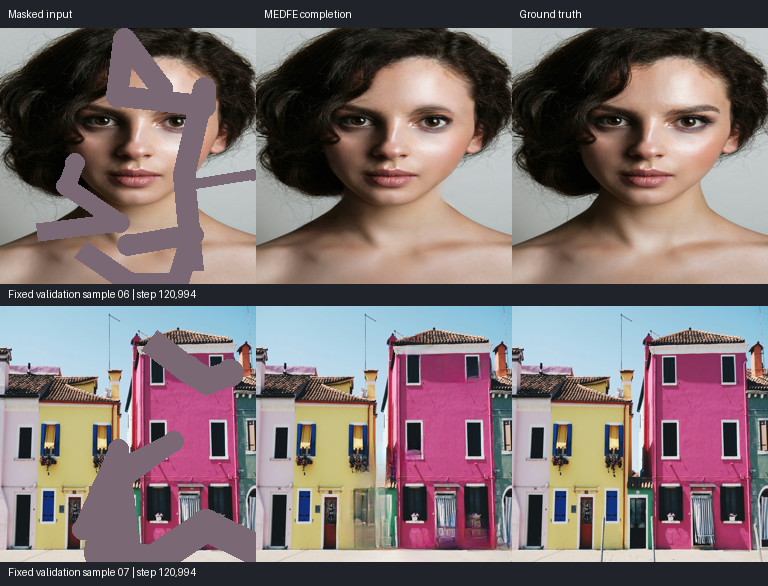

# Checkpoint and inference

The selected modern run was **paused at step120,994 on 2026-11-01** after a complete update.
It uses the `sd_partial` backbone and the small-GAN training recipe described in
[training.md](training.md). Download the generator from [KumaPower/MEDFE on Hugging Face](https://huggingface.co/KumaPower/MEDFE).

## Two files, two purposes

| File | Contents | Use |
| --- | --- | --- |
| `medfe-training-step120994.pt` | 1.864 GB: full G/D/optimizer/metric/RNG/data state | Resume with the archived training source |
| `medfe-sd-partial-step120994.pt` | 579.6 MB: FP32 generator, model/evaluation settings and checksums | Offline inference and evaluation |

The generator is [publicly available](https://huggingface.co/KumaPower/MEDFE/resolve/main/medfe-sd-partial-step120994.pt). The full training checkpoint and frozen training source are retained in the training archive.

The generator export includes no discriminator, VGG/LPIPS weights, private data paths,
or optimizer state. Its SHA256 and source checkpoint identity are recorded in
[release.json](releases/step120994/release.json). It cannot be passed to `train --resume`.
Export was verified on eight fixed examples: full checkpoint and portable bundle produced bitwise-identical FP32 outputs. The single-image CLI also passed, with known pixels preserved.

Do not describe this checkpoint as a validation-best model: it is the final safely saved state
of the paused run. The run normally overwrote `latest.pt` every100 steps.

## Export your own model

Stop training safely or copy a stable checkpoint first:

```bash
medfe export --checkpoint runs/your-run/latest.pt \
  --output checkpoints/medfe-sd-partial.pt
```

Export checks architecture/semantics, tensor keys, shapes, dtypes, finiteness and hashes.
It refuses to overwrite an existing destination or export a source that changed during the
operation. The normal inference loader accepts either supported modern format; old 2020
`.pth` files are not interchangeable with these models.

## Single image

```bash
medfe infer --checkpoint checkpoints/medfe-sd-partial.pt \
  --image examples/masked.png --mask examples/mask.png \
  --output outputs/completed.png --device cuda:0
```

White (`>127`) is missing, black is known. Image and mask must share size and orientation.
The image may already have holes filled with a constant; masked values are ignored by the
model. Inference uses FP32, pads to at least256 and a multiple of64, then crops to the original
geometry. Known uint8 pixels and alpha are preserved. No extra model downloads occur.
GPU backend/device changes can affect generated pixels, so the example is a visual reference,
not a cross-platform bitwise guarantee. Start with256² images; this checkpoint was trained
at that size and high-resolution quality/memory have not been established.

## Fixed validation

```bash
medfe evaluate --checkpoint checkpoints/medfe-sd-partial.pt \
  --manifest data/validation.jsonl --output outputs/validation \
  --limit 32 --batch-size 4 --device cuda:0
```

For an exported indexed model, the caller supplies the manifest, and the relative RTV cache
is `data/indexed-rtv-cache`. This command may create structure-cache entries even though
structure targets are not needed by the generator. Keep the manifest and protocol fixed
when comparing models; the checkpoint step by itself does not establish an improvement.

## Preview

Selected examples from the fixed local validation set. Each row is
**masked input → completion → ground truth**. Large missing people, repeated
textures, and fine facial geometry remain difficult.



The [per-image results](releases/step120994/evaluation.json) document this small local check;
they are not the paper’s benchmark results. Original sample paths have been omitted.
